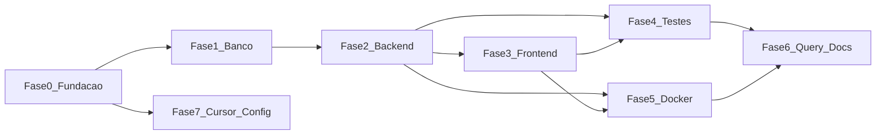

# Plano de Implementação — Mini Gestão de Pedidos

- **Referência:** [docs/spec.md](spec.md) (v1.1)
- **Status:** Fases 0–7 concluídas (Fase 6: query medida e documentação fechada; vídeo de demonstração pendente do desenvolvedor)
- **Abordagem:** AI First, com entrega incremental (um commit por etapa concluída)

---

## 1. Visão geral e premissas

### Objetivo

Entregar uma aplicação web para cadastro e consulta de pedidos e relatório dos cinco clientes com maior volume de compras, executável integralmente com `docker compose up`.

### Stack

- **Backend:** .NET 8 Web API, C#, Entity Framework Core, SQL Server, xUnit
- **Frontend:** React, TypeScript, Vite, Axios
- **Infraestrutura:** SQL Server em container, Docker Compose, Testcontainers, Git e GitHub
- **IA:** Cursor Pro, Cursor Agent

### Premissas

- Os scripts SQL em `database/` são a fonte de verdade do esquema. O EF Core é mapeado para refletir esses scripts (sem migrations como fonte principal).
- O backend é a única autoridade sobre preço, total e estoque. O frontend apenas exibe valores informativos.
- Funcionalidades fora da spec (por exemplo, endpoints de apoio, cancelamento de pedidos) só serão implementadas com aprovação prévia.
- Cada fase termina com build e testes da fase passando, e com um commit pequeno e descritivo.
- Nenhuma credencial real é versionada. Valores sensíveis vêm de variáveis de ambiente (`.env.example` no repositório).

---

## 2. Mapa de dependências entre fases

| Fase | Depende de | Pode ocorrer em paralelo com |
| ---- | ---------- | ---------------------------- |
| 0 - Fundação do repositório | Nenhuma | Fase 7 |
| 1 - Modelagem de dados | 0 | Fase 7 |
| 2 - Backend | 1 | Fase 7 |
| 3 - Frontend | 2 (contrato da API estável) | Fase 4 (parcialmente) |
| 4 - Testes | 2 (unitários e integração), 3 (E2E) | Fase 3 |
| 5 - Docker | 2 e 3 | Fase 4 |
| 6 - Otimização da query e documentação | 4 e 5 | Nenhuma |
| 7 - Configuração AI First no Cursor | 0 | Fases 1 a 5 |

---

## 3. Fases detalhadas

### Fase 0 - Fundação do repositório

**Objetivo:** preparar a estrutura base conforme a seção 10 da spec.

**Responsabilidades**

- Criar a estrutura de pastas: `docs/`, `.cursor/`, `database/`, `backend/`, `frontend/`.
- Criar `.gitignore` (.NET, Node, IDE, `.env`), `README.md` inicial e `.env.example`.
- Criar a solution .NET em `backend/` com os projetos `API`, `Application`, `Domain` e `Infrastructure` em `src/`, e `UnitTests` e `IntegrationTests` em `tests/`, com as referências entre projetos (API -> Application -> Domain; Infrastructure -> Application/Domain).
- Inicializar o repositório Git e o primeiro commit.

**Entregáveis:** repositório compilando (`dotnet build`) com projetos vazios.

**Critério de conclusão:** estrutura criada, build verde, primeiro commit realizado.

---

### Fase 1 - Modelagem de dados (`database/`)

**Objetivo:** definir o esquema SQL Server e os dados de exemplo.

**Responsabilidades**

- `01-create-tables.sql`:
  - `Clientes` (Id, Nome NVARCHAR(150), Email NVARCHAR(150), DataCadastro DATETIME2).
  - `Produtos` (Id, Nome NVARCHAR(150), Preco DECIMAL(18,2), Estoque INT).
  - `Pedidos` (Id, ClienteId FK, DataPedido DATETIME2, ValorTotal DECIMAL(18,2)).
  - `ItensPedido` (Id, PedidoId FK, ProdutoId FK, Quantidade INT, PrecoUnitario DECIMAL(18,2)).
  - Constraints: `Preco > 0`, `Estoque >= 0`, `Quantidade > 0`, chaves primárias e estrangeiras.
- `02-create-indexes.sql`: índices em `Pedidos.ClienteId`, `Pedidos.DataPedido`, `ItensPedido.PedidoId` e `ItensPedido.ProdutoId`.
- `03-seed-data.sql`: clientes, produtos e pedidos suficientes para exercitar filtros, paginação e o ranking (incluindo clientes com nomes iguais, clientes sem pedidos e pedidos fora do período).
- Scripts idempotentes ou protegidos para execução apenas em banco novo.

**Entregáveis:** três scripts SQL versionados e validados em uma instância SQL Server.

**Critério de conclusão:** scripts executam em sequência sem erro; tabelas, FKs, constraints e índices conferidos.

---

### Fase 2 - Backend (.NET 8)

**Objetivo:** implementar a API e as regras de negócio em camadas.

**Responsabilidades por camada**

- **Domain:** entidades `Cliente`, `Produto`, `Pedido`, `ItemPedido`, regras invariantes (preço > 0, estoque não negativo, quantidade > 0) e exceções de domínio.
- **Infrastructure:** `DbContext` com mapeamentos alinhados aos scripts SQL, repositórios, gerenciamento de transação única (pedido, itens e baixa de estoque).
- **Application:**
  - DTOs de request e response conforme a seção 5 da spec.
  - Validação de entrada (cliente informado, pelo menos um item, quantidade > 0).
  - Serviço de criação de pedido: verifica cliente e produtos, valida estoque, aplica o preço vigente, calcula subtotais e total, baixa o estoque, tudo em uma transação com rollback em qualquer falha.
  - Consulta paginada de pedidos com filtros e ordenação por data decrescente.
  - Relatório top 5 clientes (agregação por `Cliente.Id`, período obrigatório).
- **API:**
  - `POST /pedidos`: 201, 400, 404, 409 e 500.
  - `GET /pedidos`: filtros `clienteId`, `dataInicio`, `dataFim`, `page`, `pageSize`; resposta `{ items, page, pageSize, totalItems, totalPages }`.
  - `GET /relatorios/top-clientes`: `dataInicio` e `dataFim` obrigatórios; resposta com `clienteId`, `nome` e `totalComprado`.
  - Middleware global de tratamento de erros com mapeamento para os códigos HTTP, CORS para o frontend e configuração por variáveis de ambiente.
  - Endpoints de apoio (listar clientes e produtos) necessários ao frontend: **fora da spec, dependem de aprovação do desenvolvedor.**

**Entregáveis:** API funcional contra o banco criado na Fase 1, com Swagger para verificação manual.

**Critério de conclusão:** os três endpoints respondem conforme a spec e as regras da seção 3 são respeitadas.

---

### Fase 3 - Frontend (React + TypeScript + Vite)

**Objetivo:** interface para listar e criar pedidos.

**Responsabilidades**

- Projeto Vite com React e TypeScript em `frontend/`.
- Camada de acesso à API com Axios (URL base por variável de ambiente) e tipos TypeScript dos contratos.
- **Tela de listagem:** tabela (id, cliente, data, valor total), filtro por cliente, filtro por período, paginação e botão de novo pedido.
- **Modal de criação:** seleção de cliente, seleção de produtos, quantidades, subtotais e total apenas informativos, confirmação e exibição de mensagens de sucesso e erro retornadas pela API (400, 404, 409).
- Atualização da listagem após criação bem-sucedida.
- O frontend não determina preço definitivo nem valida estoque final.

**Entregáveis:** aplicação rodando em desenvolvimento integrada à API.

**Critério de conclusão:**

- [x] Axios e tipos TypeScript alinhados aos DTOs da API (`VITE_API_URL`).
- [x] Listagem com tabela (id, cliente, data, valor total), filtros por cliente e período e paginação.
- [x] Modal de criação com subtotais/total apenas informativos e tratamento de erros 400/404/409.
- [x] Listagem atualizada após criação bem-sucedida; frontend não decide preço nem estoque.
- [x] `npm run lint` e `npm run build` no `frontend/` sem erros.

**Status:** concluída.

---

### Fase 4 - Testes

**Objetivo:** cobrir as regras de negócio e os fluxos principais.

**Responsabilidades**

- **Unitários (xUnit):**
  - Criação de pedido com dados válidos.
  - Cliente inexistente e produto inexistente.
  - Estoque insuficiente, pedido sem itens e quantidade inválida.
  - Cálculo correto do valor total.
  - Atualização correta do estoque.
  - Falha transacional (nenhuma alteração parcial persistida).
- **Integração (xUnit + Testcontainers + SQL Server real):**
  - `POST /pedidos` com sucesso, cliente inexistente e estoque insuficiente.
  - `GET /pedidos` com filtros e paginação.
  - `GET /relatorios/top-clientes` com dados persistidos.
- **E2E (Playwright, diferencial):** acessar a aplicação, criar um pedido e verificar o pedido na listagem.

**Entregáveis:** projetos de teste executáveis com `dotnet test` e, para E2E, script do Playwright documentado.

**Critério de conclusão:**

- [x] Testes unitários (Domain/Application) cobrindo criação válida, 404s, estoque, validação, total, estoque debitado e falha transacional.
- [x] Testes de integração com SQL Server real em Docker (`WebApplicationFactory` + scripts `database/`), cobrindo POST /pedidos (201/404/409/400), GET /pedidos e top-clientes.
- [x] E2E Playwright (`e2e/`) criando pedido e validando a listagem.
- [x] `dotnet test` e `npm test --prefix e2e` documentados no README.

**Status:** concluída.

---

### Fase 5 - Docker

**Objetivo:** execução integral com `docker compose up`.

**Responsabilidades**

- `Dockerfile` da API (build multi-stage) e do frontend (build Vite servido por servidor HTTP).
- `docker-compose.yml` na raiz com:
  - `sqlserver`: imagem oficial, healthcheck, volume, scripts de `database/` executados automaticamente na inicialização de um banco novo.
  - `api`: `depends_on` com condição `service_healthy`, connection string por variável de ambiente.
  - `frontend`: porta HTTP exposta, URL da API configurável.
- `.env.example` com todas as variáveis necessárias, sem segredos reais.

**Entregáveis:** ambiente completo subindo com um único comando.

**Critério de conclusão:**

- [x] Dockerfile multi-stage da API (.NET 8 SDK + ASP.NET 8 runtime) e do frontend (Node 22 + Nginx Alpine).
- [x] `docker-compose.yml` com `sqlserver` (healthcheck + volume), `db-init` (scripts 01–03), `api` e `frontend`.
- [x] `.env.example` com todas as variáveis, sem segredos reais.
- [x] Em projeto Compose isolado, `docker compose up` entrega banco populado, API e frontend acessíveis.

**Status:** concluída.

---

### Fase 6 - Otimização da query e documentação

**Objetivo:** validar a query do ranking e fechar a documentação.

**Responsabilidades**

- Executar e comparar a query original e a otimizada (seção 7 da spec) no SQL Server:
  - Plano de execução estimado e real.
  - Índices existentes.
  - Quantidade de registros envolvidos.
  - Leituras lógicas (`SET STATISTICS IO`) e custo das operações.
- Registrar no README os problemas identificados e o resultado da comparação.
- Completar o README com: como executar, como rodar os testes, decisões técnicas, uso do Cursor (tarefas realizadas, resultados, correções necessárias, reflexões), limitações conhecidas.
- Atualizar este `plan.md` com ajustes e decisões da execução.
- Preparar o vídeo de demonstração (até 10 minutos).

**Critério de conclusão / checklist**

- [x] Query original (texto do e-mail do teste, fornecido pelo desenvolvedor) e otimizada (spec) executadas e comparadas em SQL Server 2022.
- [x] Planos estimados (`SHOWPLAN_TEXT`), índices, volume e `STATISTICS IO/TIME` registrados em `docs/perf/` e no README.
- [x] Corretude no seed: otimizada retorna clientes 1, 2, 3, 7 e 4; original funde homônimos e ordena ASC.
- [x] Volume sintético em projeto Compose isolado (~500k pedidos); índices de cobertura avaliados sem alterar `02-create-indexes.sql`.
- [x] README completo: execução (Compose e local), testes, decisões, Cursor, limitações, resultado da query.
- [x] Este `plan.md` atualizado (ajustes, decisões, status da fase).
- [ ] Vídeo de demonstração (até 10 minutos) — **pendente, responsabilidade do desenvolvedor**.

**Decisões finais desta fase**

- A query original usada na comparação é a do enunciado/e-mail (não reconstruída).
- Medição em banco descartável (`PerfExperiment`, `docker compose -p perf`) para não poluir o desenvolvimento.
- Com ~67% dos pedidos em 2026, o otimizador manteve *Clustered Index Scan* em `Pedidos` mesmo com range sargável; o ganho principal da otimizada é corretude + CPU (~27%), não redução drástica de I/O. Índices de cobertura ficam como recomendação opcional.

**Entregáveis:** README completo, `docs/perf/`, scripts em `database/optional/perf/` e este `plan.md` atualizado.

**Status:** concluída (exceto vídeo).

---

### Fase 7 - Configuração AI First no Cursor

**Objetivo:** configurar o Cursor para guiar o desenvolvimento (pode começar logo após a Fase 0 e evoluir durante o projeto).

**Responsabilidades**

- **Rules** em `.cursor/rules/`: `project-standards.mdc`, `backend-standards.mdc` e `frontend-standards.mdc`, cobrindo arquitetura, nomenclatura, padrões de backend e frontend, convenções de testes, comandos de build/teste/execução e a regra de não implementar funcionalidades fora do escopo sem aprovação.
- **Hook** (`.cursor/hooks.json` e `.cursor/hooks/validate-build.sh`): validação de build ou formatação após alterações relevantes, impedindo considerar a alteração concluída se a validação falhar. Documentado no README.
- **Skill** `create-endpoint` (`.cursor/skills/create-endpoint/SKILL.md`): DTOs, validação de entrada, lógica de negócio, tratamento de erros, persistência e testes unitários e de integração.
- **MCP** (`.cursor/mcp.json`): conexão ao SQL Server para consultar estrutura, relacionamentos, dados de exemplo e apoiar a otimização de queries; sem credenciais reais, preferencialmente com usuário somente leitura. Documentar configuração, uso, limitações e cuidados no README.

**Entregáveis:** configuração versionada e documentada.

**Critério de conclusão:**

- [x] Rules (`project-standards.mdc`, `backend-standards.mdc`, `frontend-standards.mdc`) criadas em `.cursor/rules/`.
- [x] Hook `stop` configurado em `.cursor/hooks.json` e `.cursor/hooks/validate-build.sh` validado (build do backend e do frontend, sucesso e falha), documentado no README.
- [x] Skill `create-endpoint` criada em `.cursor/skills/create-endpoint/SKILL.md`.
- [x] MCP SQL Server configurado em `.cursor/mcp.json` sem credenciais (`.env.mcp` ignorado pelo Git, `.env.mcp.example` versionado) e script opcional `database/optional/create-readonly-user.sql` validado.
- [x] Seção "Configuração AI First no Cursor" no README, com limitações e cuidados do MCP.

**Status:** concluída. Observação: o servidor MCP (`mssql-read-only-mcp@1.0.2`) depende de pacote de terceiros executado via `npx`; ative-o em Cursor Settings > MCP após criar o `.env.mcp`.

---

## 4. Ajustes do desenvolvedor e decisões alteradas ou rejeitadas

### Ajustes realizados pelo desenvolvedor

- **TypeScript:** a menção a “TypeScript 8” na demanda foi corrigida para **7.0.2** (versão estável existente), com `strict: true`.
- **Escopo da listagem:** o pedido de coluna “nome do pedido” foi esclarecido — a UI lista produtos dos itens; um pedido pode ter vários produtos.
- **Endpoints de apoio:** `GET /clientes` e `GET /produtos` aprovados explicitamente para o frontend (fora da spec).
- **Hook no Windows:** opção `gitbash_abs` — `hooks.json` chama `C:\PROGRA~1\Git\bin\bash.exe` (evita stub WSL).
- **API local:** connection string via variável de ambiente e scripts 01–03 aplicados no container para destravar o teste manual.
- **Query original (Fase 6):** texto exato fornecido a partir do e-mail do teste (não reconstrução).

### Decisões alteradas ou rejeitadas

| Decisão original (IA) | Alternativa adotada | Justificativa técnica |
| --------------------- | ------------------- | --------------------- |
| Testcontainers.MsSql para integração | Fixture via CLI do Docker | Docker.DotNet lança `NotImplementedException` no named pipe com .NET 11 no Windows |
| IntegrationTests em `net8.0` | TFM `net11.0` + Mvc.Testing 11 | TestHost incompatível com roll-forward net8 + runtime 11 (`PipeWriter.UnflushedBytes`) |
| FluentAssertions 8.x | FluentAssertions 6.12.2 | 8.x exige licença comercial |
| `container_name` fixo no Compose | Sem `container_name` | Permite projetos Compose paralelos (`-p perf`, etc.) |
| Middleware com `WriteAsync` via PipeWriter avançado | `HttpResponse.WriteAsync` do JSON serializado | Evita erro de API do TestHost no cenário net8/net11 |
| Reconstruir a query original a partir da lista de problemas | Usar o SQL enviado no e-mail do teste | Fonte autoritativa do enunciado |

---

## 5. Riscos e pontos de atenção

- **Concorrência na baixa de estoque:** dois pedidos simultâneos podem esgotar o mesmo estoque. Mitigar com transação e atualização condicional (`UPDATE ... WHERE Estoque >= quantidade`) ou controle de concorrência.
- **Filtro por período:** usar limite superior exclusivo (`DataPedido < dataFim + 1 dia`) para incluir todo o último dia, e evitar funções como `YEAR()` sobre a coluna filtrada.
- **Ordem de inicialização:** a API só deve subir após o SQL Server estar saudável e os scripts executados. Usar healthcheck e `depends_on` com `service_healthy`.
- **Scripts em banco novo:** a imagem do SQL Server não executa scripts automaticamente. Prever um container ou entrypoint de inicialização.
- **Testcontainers:** exige Docker disponível na máquina que roda os testes de integração.
- **Escopo:** endpoints de apoio ao frontend (clientes e produtos) não constam na spec e exigem aprovação.
- **Código gerado por IA:** nada é considerado correto sem revisão, execução dos testes e validação manual.

---

## 6. Rastreabilidade com os critérios de aceite

| Critério de aceite (spec, seção 12) | Fase |
| ----------------------------------- | ---- |
| O banco SQL Server possui as quatro tabelas requeridas | 1 |
| Chaves primárias, estrangeiras e índices configurados | 1 |
| Scripts de criação e carga de dados versionados | 1 |
| API permite criar pedidos com validação de cliente e estoque | 2 |
| API permite listar pedidos com filtros e paginação | 2 |
| API permite consultar o ranking dos cinco maiores clientes | 2 |
| Frontend permite criar e consultar pedidos | 3 |
| Testes unitários cobrem as regras de negócio | 4 |
| Testes de integração executam contra SQL Server real | 4 |
| Query otimizada documentada no README | 6 |
| Projeto sobe com Docker Compose | 5 |
| README documenta execução, testes e decisões técnicas | 6 |
| Cursor configurado com Rules, Hooks, Skills e MCP | 7 |
| Plano de implementação elaborado com o Cursor e documentado | Este documento (atualizado na Fase 6) |
| Histórico de commits demonstra evolução incremental | Todas (um commit por etapa) |
| Vídeo de demonstração com até 10 minutos | 6 |
